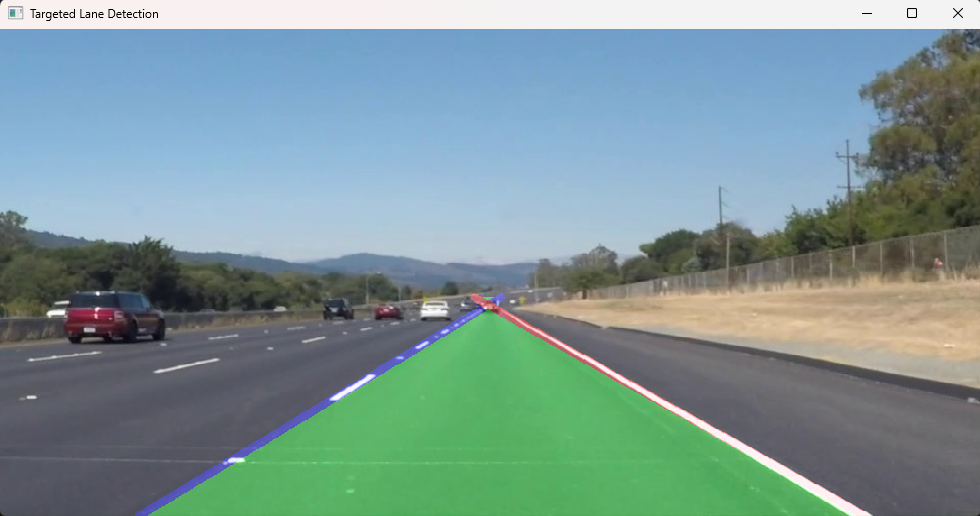

# 🛣️ Autonomous Lane Detection

A classical computer vision pipeline that detects lane boundaries in dashcam footage and highlights the drivable space in real time. No deep learning required: just OpenCV, NumPy, and some geometry.


---

## 📸 Output



*The left lane boundary is drawn in **blue**, the right lane boundary in **red**, and the drivable area between them is filled with a transparent **green** overlay.*

---

## ✨ Features

- **Classical CV pipeline:** Grayscale conversion, Gaussian blur, Canny edge detection, and Region of Interest (ROI) masking isolate the structural road edges.
- **Slope-based lane separation:** The Probabilistic Hough Transform finds line segments, which are classified as left or right lane by slope. Near-horizontal segments are discarded as noise.
- **Stable extrapolation:** NumPy (`polyfit`, `average`) computes each segment's slope and intercept, averages them per lane, and extends one clean line per side across the lower part of the frame.
- **Targeted ROI:** A custom trapezoid mask blocks out the left guardrail and other distractions so the detector locks onto the lane the vehicle is driving in.
- **Interactive GUI:** A Tkinter file picker lets you load videos of any resolution (`.mp4`, `.avi`, `.mov`, `.mkv`).
- **Dynamic rendering:** A resizable display window and a semi-transparent polygon overlay (35% opacity) show the drivable space.

---

## ⚙️ How It Works

```
Video frame
   │
   ▼
Grayscale ─► Gaussian Blur (5×5) ─► Canny Edges (50 / 150)
                                          │
                                          ▼
                       Trapezoid ROI mask (ignores left 35%)
                                          │
                                          ▼
                    Probabilistic Hough Transform (HoughLinesP)
                                          │
                                          ▼
          Per-segment slope & intercept via np.polyfit (degree 1)
                                          │
                  slope < -0.4 → left      slope > 0.4 → right
                                          │
                                          ▼
              Average each side → extend to full lane length
                                          │
                                          ▼
       Fill drivable area + draw lane lines → blend onto frame
```

| Step | Function | What it does |
|------|----------|--------------|
| 1 | `find_edges` | Converts to grayscale, applies a 5×5 Gaussian blur, then runs Canny edge detection. |
| 2 | `isolate_road` | Masks everything outside a trapezoid. The left 35% of the frame is ignored to block the guardrail, and the top 55% is ignored to remove the sky and horizon clutter. |
| 3 | `HoughLinesP` | Detects line segments (`rho=2`, `theta=1°`, `threshold=50`, `minLineLength=30`, `maxLineGap=100`). |
| 4 | `average_slope_intercept` | Fits each segment, keeps those with \|slope\| > 0.4, and averages them into one left and one right line. |
| 5 | `make_coordinates` | Converts the averaged slope and intercept into pixel endpoints from the bottom of the frame up to 55% of the height. |
| 6 | `draw_lane_overlay` | Fills the area between the lanes in green, then draws the left line in blue and the right line in red. |
| 7 | `process_frame` | Blends the overlay onto the original frame with `cv2.addWeighted`. |

---

## 🧰 Tech Stack

| Category  | Tools                          |
|-----------|--------------------------------|
| Language  | Python 3.11                    |
| Libraries | OpenCV (`cv2`), NumPy, Tkinter |

---

## 🚀 Getting Started

### 1. Clone the repository

```bash
git clone https://github.com/Venu277/Lane-Detection.git
cd Lane-Detection
```

### 2. (Optional) Create a virtual environment

```bash
python -m venv venv
# Windows
venv\Scripts\activate
# macOS / Linux
source venv/bin/activate
```

### 3. Install dependencies

```bash
pip install -r requirements.txt
```

> **Note:** Tkinter ships with the standard Python installer on Windows and macOS. On Debian/Ubuntu, install it with `sudo apt install python3-tk`.

### 4. Run

```bash
python lane_detection.py
```

A file dialog opens. Select a dashcam video and the **Targeted Lane Detection** window will play the processed output. Press **`q`** to quit.

---

## 🎛️ Tuning for Your Own Footage

The ROI and thresholds are tuned for a forward-facing dashcam on a multi-lane highway. For different footage, adjust these values in `lane_detection.py`:

| Parameter | Location | Effect |
|-----------|----------|--------|
| `0.35`, `0.45` (ROI x-coordinates) | `isolate_road` | Horizontal bounds of the region that is scanned for lanes |
| `0.55` (ROI top / lane end height) | `isolate_road`, `make_coordinates` | How far up the frame lanes are detected and drawn |
| `50, 150` | `find_edges` | Canny low and high thresholds, which control edge sensitivity |
| `±0.4` | `average_slope_intercept` | Minimum slope for a segment to count as a lane |
| `threshold`, `minLineLength`, `maxLineGap` | `process_frame` | Hough sensitivity and how line segments are merged |
| `0.35` (alpha) | `process_frame` | Opacity of the green overlay |

---

## 📁 Project Structure

```
Lane-Detection/
├── assets/
│   └── output.png        # Sample output shown in this README
├── lane_detection.py     # Pipeline + Tkinter file picker + display loop
├── requirements.txt      # Python dependencies
├── .gitignore
└── README.md
```

---

## ⚠️ Limitations

- The ROI is **hard-coded** and ignores the left 35% of the frame, so the detector favors the lane on the right side of the view. It will not track lanes on the far left.
- Lanes are modeled as **straight lines**, so sharp curves are only approximated.
- There is **no temporal smoothing**, so lines can jitter between frames, and if only one lane line is detected in a frame, no overlay is drawn.
- Performance can drop with heavy shadows, glare, rain, night driving, or worn lane paint.
- A very different camera angle or mounting position will need the ROI re-tuned.

---

## 🔮 Future Improvements

- Temporal smoothing (e.g. averaging over the last N frames) to remove jitter
- Curved-lane fitting with 2nd-degree polynomial regression
- Perspective (bird's-eye) transform for better curve handling
- Color-space thresholding (HLS/HSV) to pick out white and yellow markings under varied lighting
- Automatic ROI based on frame size and vanishing point instead of hard-coded ratios
- Option to save the processed video to disk
- Lane departure warnings and vehicle offset estimation

---

## 🤝 Contributing

Suggestions and pull requests are welcome. Feel free to open an issue to discuss what you'd like to change.

---

## 👤 Author

**Venu**: [@Venu277](https://github.com/Venu277)

If you found this project useful, consider giving it a ⭐!
